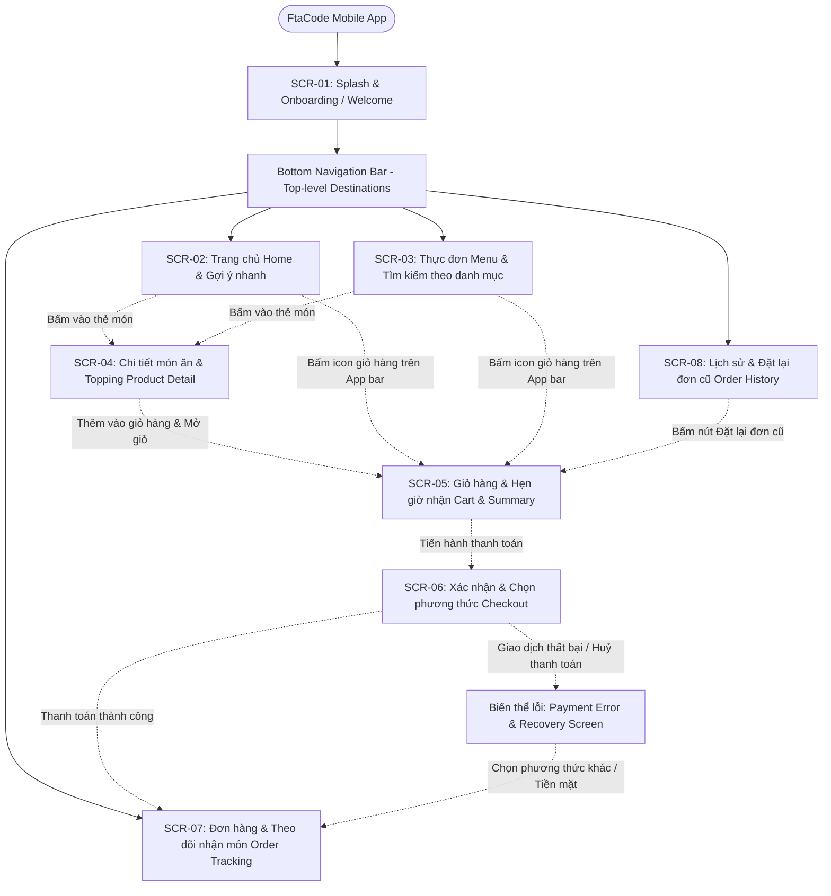
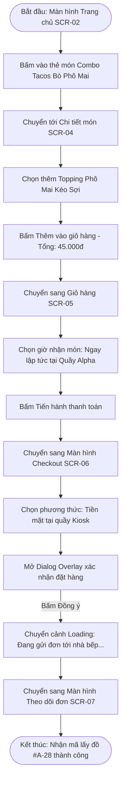
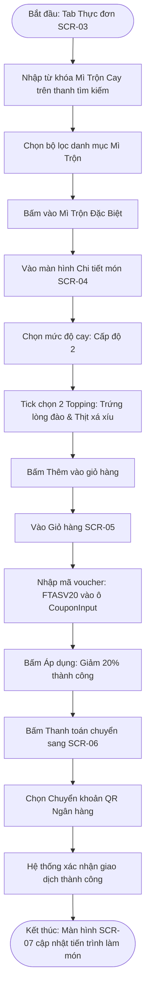
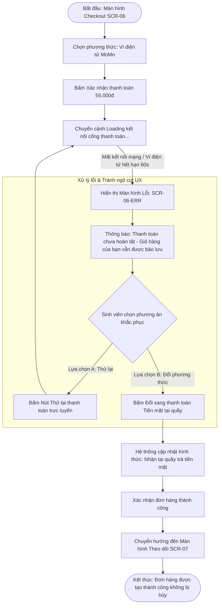

# UX Analysis: Information Architecture & User Flows

> **Tài liệu:** `ux/user-flow.md`  
> **Dự án:** FtaCode Mobile App — Campus Quick Food Ordering  
> **Môn học:** PRM323 — Lab 2  

---

## 1. Information Architecture (Kiến trúc thông tin & Phân cấp màn hình)

Kiến trúc thông tin của ứng dụng **FtaCode** được thiết kế theo cấu trúc điều hướng phân cấp (Hierarchical Navigation) kết hợp thanh điều hướng dưới đáy (Bottom Navigation Bar) 4 tabs chính, tối ưu hóa cho thao tác bằng một tay của sinh viên khi di chuyển.

### 1.1 Phân cấp màn hình (Screen Hierarchy)

### 1.2 Danh mục kiểm kê màn hình (Screen Inventory)

Ứng dụng bao gồm **8 màn hình chính độc lập** (không tính popup dialog hoặc các biến thể trạng thái):

| Mã màn hình | Tên màn hình (Screen Name) | Cấp độ (Level) | Mục đích & Nội dung cốt lõi |
| :---: | :--- | :---: | :--- |
| **SCR-01** | **Splash & Onboarding** | Entry Level | Giới thiệu giá trị cốt lõi (Đặt món siêu tốc 15 phút, Hẹn giờ lấy tại Kiosk, Nhận ưu đãi sinh viên). Bấm Bắt đầu để vào app. |
| **SCR-02** | **Home & Quick Discovery** | Top-level (Tab 1) | Banner sự kiện, danh mục món ăn (Tacos, Mì trộn, Đồ uống), thanh tìm kiếm nhanh, danh sách gợi ý "Món lấy nhanh dưới 5 phút". |
| **SCR-03** | **Menu & Filter Search** | Top-level (Tab 2) | Danh mục thực đơn đầy đủ phân chia theo nhóm tab; bộ lọc theo mức giá và món ăn kèm; danh sách sản phẩm hiển thị dạng danh sách/lưới. |
| **SCR-04** | **Product Detail & Topping** | Nested Screen | Hình ảnh lớn của món ăn, bảng nguyên liệu, tùy chọn chọn cỡ (size), danh sách chọn thêm Topping (trứng non, bò viên, phô mai) và ghi chú độ cay. Nút CTA ghim đáy hiển thị tổng tiền động. |
| **SCR-05** | **Cart & Order Summary** | Nested Screen | Danh sách các món đã chọn kèm bộ tăng giảm số lượng (+/-); ô nhập mã giảm giá sinh viên (`CouponInput`); tùy chọn hẹn giờ nhận món tại quầy Kiosk. |
| **SCR-06** | **Checkout & Payment Method** | Nested Screen | Xem lại tóm tắt hóa đơn (tổng tiền món, giảm giá, số tiền thanh toán cuối cùng); danh sách phương thức thanh toán (MoMo, Chuyển khoản QR sinh viên, Tiền mặt tại Kiosk); nút Xác nhận đặt đơn. |
| **SCR-07** | **Order Tracking & Pickup** | Top-level (Tab 3) | Hiển thị tiến trình đơn hàng 4 bước (Chờ xác nhận $\to$ Đang chế biến $\to$ Sẵn sàng nhận tại quầy $\to$ Hoàn tất); Mã số nhận đồ cỡ lớn kèm mã QR quét tại Kiosk; nút Hủy đơn/Trợ giúp. |
| **SCR-08** | **Order History & Reorder** | Top-level (Tab 4) | Danh sách các đơn hàng đã đặt trong tuần/tháng; trạng thái đơn; nút "Đặt lại 1 chạm" (Re-order) đưa toàn bộ món của đơn cũ vào giỏ hàng ngay lập tức. |

---

## 2. Chi tiết 3 User Flows (Sơ đồ luồng người dùng)

### 2.1 Flow 1: Đặt món nhanh tại khuôn viên trường (Quick Campus Pickup - Happy Path)
* **Điểm bắt đầu (Start):** Sinh viên mở ứng dụng tại màn hình Trang chủ (`SCR-02`).
* **Mục tiêu (Goal):** Đặt một combo bữa phụ yêu thích và nhận mã lấy đồ tại quầy trong giờ giải lao.
* **Điểm kết thúc (End):** Màn hình Theo dõi đơn hàng (`SCR-07`) hiển thị mã lấy đồ sẵn sàng.

---

### 2.2 Flow 2: Tìm kiếm, tùy chỉnh món & áp dụng mã giảm giá sinh viên (Alternative Path)
* **Điểm bắt đầu (Start):** Sinh viên vào tab Thực đơn (`SCR-03`).
* **Mục tiêu (Goal):** Tìm món mì trộn cay, chọn mức cay, thêm nhiều topping và áp dụng mã giảm giá `FTASV20`.
* **Điểm kết thúc (End):** Hoàn tất thanh toán với giá ưu đãi và chuyển sang trạng thái theo dõi đơn.

---

### 2.3 Flow 3: Xử lý lỗi thanh toán & Phục hồi đơn hàng (Error & Recovery Path - Bắt buộc)
* **Điểm bắt đầu (Start):** Sinh viên đang ở bước thanh toán cuối cùng tại `SCR-06`.
* **Mục tiêu (Goal):** Hoàn tất đơn hàng ngay cả khi giao dịch trực tuyến bị gián đoạn hoặc hết hạn mà **không bị mất giỏ hàng**.
* **Nhánh lỗi (Error Path):** Cổng thanh toán MoMo/Ngân hàng phản hồi lỗi (mất kết nối hoặc hết hạn phiên giao dịch).
* **Nhánh phục hồi (Recovery Path):** Ứng dụng hiển thị thông báo lỗi rõ ràng bằng tiếng Việt, cung cấp 2 nút hành động: "Thử lại cổng thanh toán" hoặc "Chuyển sang trả tiền mặt tại quầy" $\rightarrow$ Đơn hàng được giữ nguyên và phục hồi thành công.

---

## 3. Bảng ánh xạ Luồng người dùng sang Màn hình (Flow-to-Screen Mapping)

Bảng dưới đây chứng minh mọi màn hình trong ứng dụng đều được ít nhất một luồng người dùng sử dụng hợp lý, không tồn tại màn hình mồ côi (orphan screen) hay ngõ cụt:

| Mã màn hình | Tên màn hình | Flow 1: Quick Pickup | Flow 2: Customize & Voucher | Flow 3: Error & Recovery |
| :---: | :--- | :---: | :---: | :---: |
| **SCR-01** | Splash & Onboarding | Bước khởi đầu cài đặt | — | — |
| **SCR-02** | Home & Quick Discovery | ✅ Điểm bắt đầu (Start) | — | — |
| **SCR-03** | Menu & Filter Search | — | ✅ Điểm bắt đầu (Start) | — |
| **SCR-04** | Product Detail & Topping | ✅ Chọn món nhanh | ✅ Chọn mức cay & topping | — |
| **SCR-05** | Cart & Order Summary | ✅ Xem lại giỏ hàng | ✅ Nhập mã voucher | ✅ Lưu giữ giỏ hàng |
| **SCR-06** | Checkout & Payment | ✅ Chọn trả tại quầy | ✅ Chọn quét mã QR | ✅ Nơi phát sinh lỗi |
| **SCR-06-ERR**| Payment Error & Recovery | — | — | ✅ Màn hình phục hồi lỗi |
| **SCR-07** | Order Tracking & Pickup | ✅ Điểm kết thúc (End) | ✅ Điểm kết thúc (End) | ✅ Phục hồi thành công |
| **SCR-08** | Order History & Reorder | Lưu vào lịch sử | Lưu vào lịch sử | Lưu vào lịch sử |
